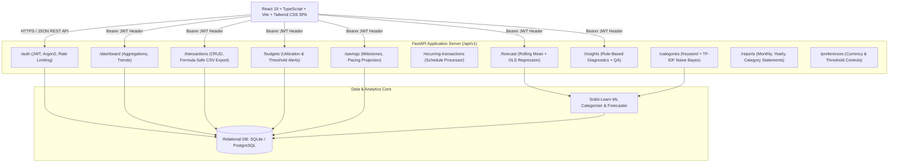

# FinWise AI — System Architecture & Technical Design

## 1. Executive Summary

**FinWise AI** is a production-oriented, full-stack personal finance management and expense analytics platform designed to solve everyday personal budgeting, expense tracking, and savings management challenges. The platform incorporates deterministic financial arithmetic, time-series spending forecasting, automated hybrid transaction categorization, and an interactive natural-language QA advisor.

---

## 2. Architecture Diagram

---

## 3. Layer Separation of Responsibilities

### 3.1 Frontend Client (React 19 + Vite + TypeScript)
- **Role**: Presentation and user interaction layer.
- **State & Context**:
  - `AuthContext`: Manages user credentials, authentication token persistence in localStorage, and dynamic multi-currency formatting (`INR (₹)`, `USD ($)`, `EUR (€)`, `GBP (£)`).
  - `ToastContext`: Dispatches non-blocking notifications, error diagnostics, and success confirmations.
- **Routing**: `react-router-dom` with strict `ProtectedRoute` barriers ensuring unauthenticated visitors cannot access sensitive financial pages.
- **Data Visualization**: Recharts for responsive cash flow trajectory bar charts, category donut charts, and time-series forecast bands.

### 3.2 Backend API (FastAPI + Pydantic v2)
- **Role**: Business logic enforcement, security validation, and deterministic arithmetic.
- **Security & Authorization**:
  - Passwords hashed using **Argon2** (PHC winner).
  - Stateless JSON Web Tokens (**JWT**) signed using HMAC-SHA256 (`HS256`).
  - Strict user isolation in every SQL query filtering on `current_user.id`.
- **Database Abstraction**: SQLAlchemy 2.0 ORM with Alembic schema migrations.

### 3.3 Analytics & Machine Learning Engine
- **Expense Categorizer (`ExpenseCategorizer`)**:
  - High-precision keyword dictionary for common merchants (Swiggy, Uber, Netflix, Amazon, etc.).
  - Scikit-learn pipeline pairing `TfidfVectorizer` (unigrams + bigrams) with `MultinomialNB` for predictive generalization on arbitrary transaction descriptions.
  - Returns classification confidence score; prompts for manual confirmation if confidence falls below threshold.
- **Forecasting Engine (`forecasting.py`)**:
  - Requires at least 2 distinct historical monthly data points.
  - Synthesizes a 3-month rolling mean with ordinary least squares (OLS) linear trend regression.
  - Projects next month spending alongside an 80% confidence interval band based on standard deviation of residuals.
  - Automatically compares forecast against active monthly budget envelopes to flag deficit risk.

---

## 4. Security & Privacy Architecture

1. **Deterministic Calculations**: Financial totals, savings rates, and budget utilizations are calculated strictly via relational database aggregation to eliminate hallucinations.
2. **Formula Injection Sanitization (CWE-1236)**: All user-controlled text cells exported via CSV are sanitized by escaping formula triggers (`=`, `+`, `-`, `@`, `\t`, `\r`).
3. **No Financial Risk**: The system operates as an analytical ledger and does not connect to real banking APIs, store bank credentials, or initiate wire transfers.
4. **Data Isolation**: Multi-tenant database design where all records link via foreign key to `users.id` and are indexed accordingly.
