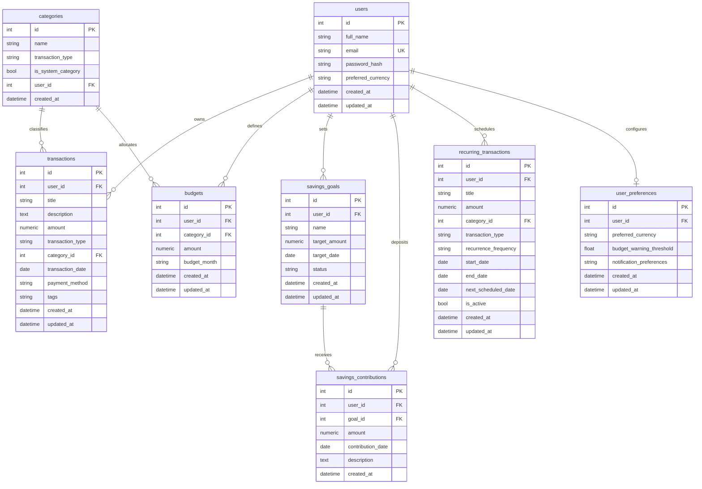

# FinWise AI — Relational Database Schema Design

## 1. Schema Overview

The database is designed with normalized tables, relational foreign keys, cascade deletion rules, and indexing on frequent query filters (`user_id`, `transaction_date`, `budget_month`, `category_id`).

---

## 2. Table Specifications

### 2.1 `users`
- Stores registered identities.
- `password_hash` stores salted Argon2 hashes. Plaintext passwords are never saved.

### 2.2 `categories`
- Pre-populated with system categories (`is_system_category = True`).
- Supports user-defined custom categories where `user_id` matches the creator.

### 2.3 `transactions`
- The core financial ledger.
- `amount` is stored with precision `Numeric(12, 2)` to avoid IEEE-754 floating-point inaccuracies.
- Enforces relational consistency: category must match transaction type.

### 2.4 `budgets`
- Sets monthly spending caps per category or globally.
- Unique constraint on `(user_id, category_id, budget_month)` prevents duplicate envelope allocations.

### 2.5 `savings_goals` & `savings_contributions`
- Tracks milestone funds independently from monthly operational cash flow to ensure zero double-counting.

### 2.6 `recurring_transactions`
- Holds scheduled recurring templates for rent, bills, subscriptions, and salaries.
